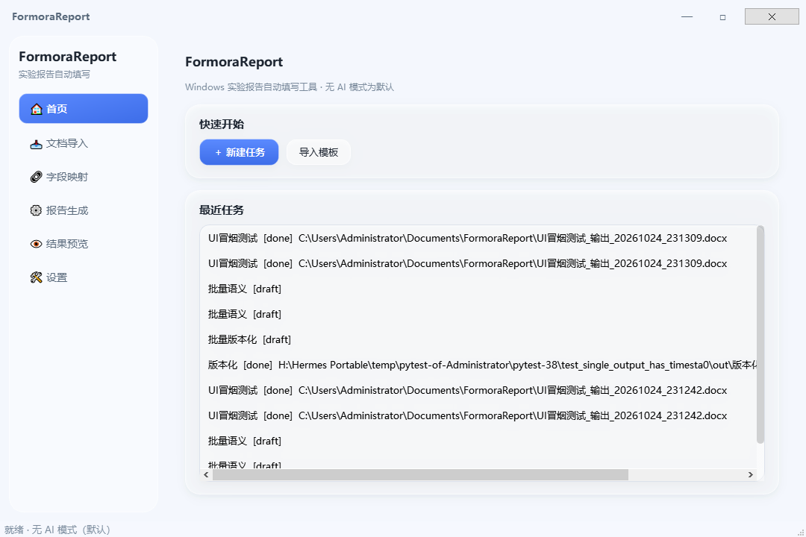
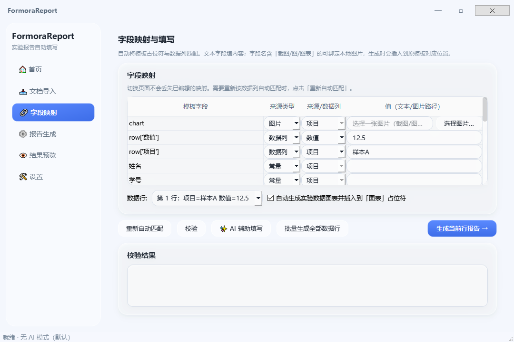
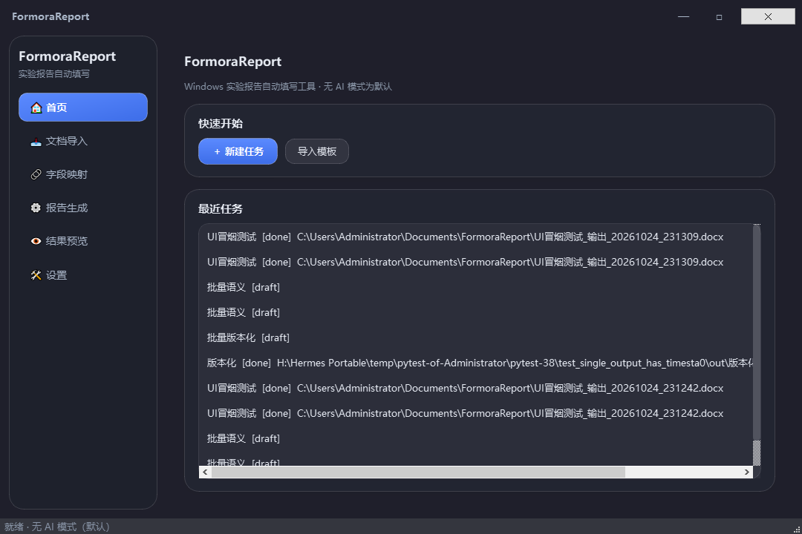
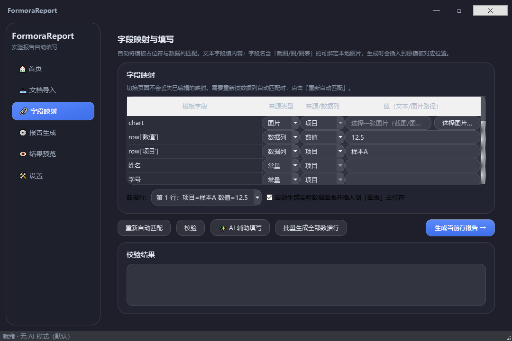
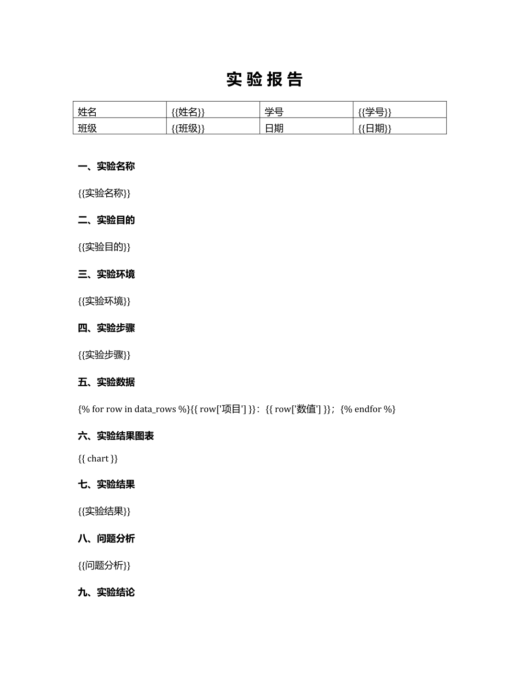
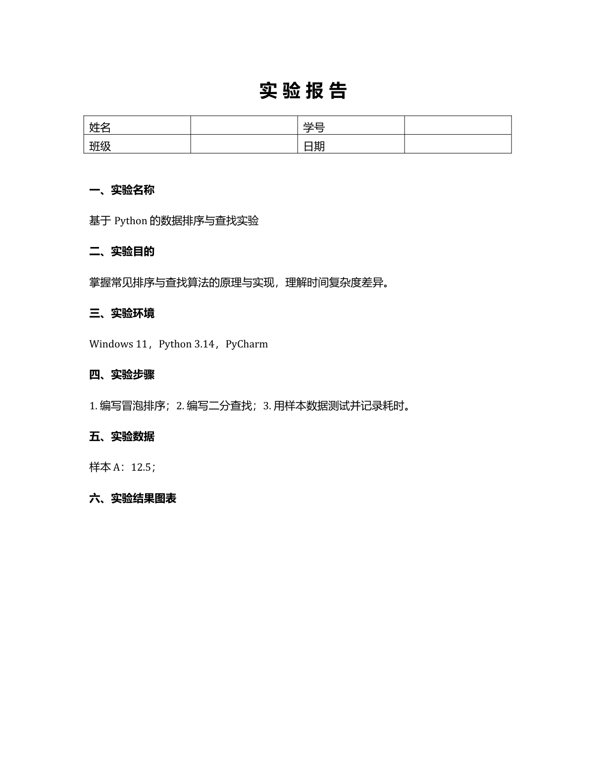
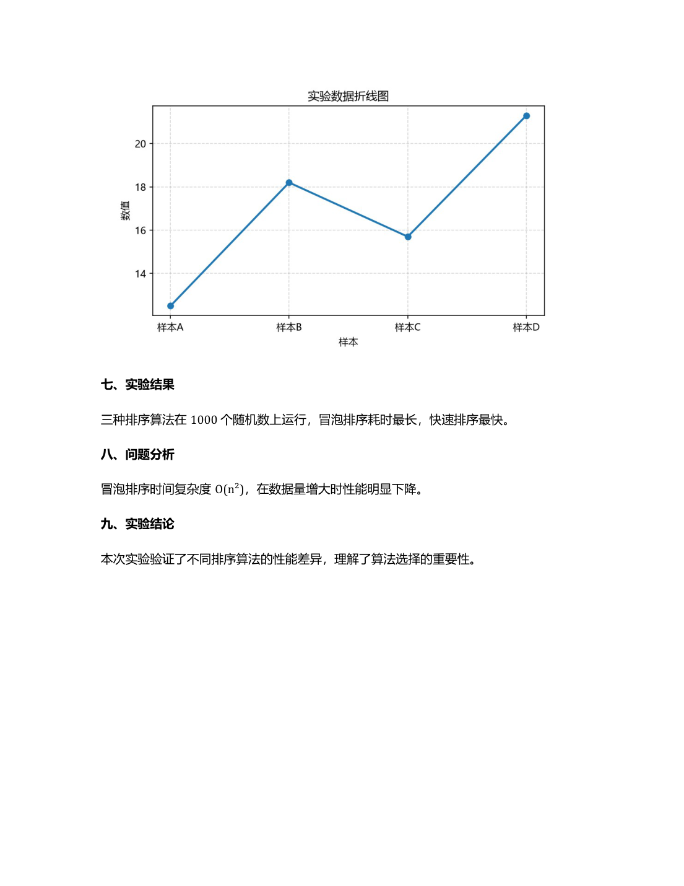

# FormoraReport

[**English**](README.md) | **中文**

Windows 实验报告自动填写工具 —— 导入实验报告模板、实验数据与素材（截图/源代码/SQL/日志），自动识别字段、整理内容、生成图表并插入原模板正确位置，导出规范、可编辑的 **Word** 与 **PDF**。

> **无 AI 模式为默认**：断网、无 API 密钥也能完成全部核心功能。
> **AI 模式可选**：由你主动启用，配置你自己的模型 API，所有生成内容可逐项审核。

---

## 界面效果

*液态玻璃 UI · 浅色模式*




*深色模式*




*测试模板与生成报告效果（LibreOffice 真实渲染）*





## 功能特性

- 📄 **DOCX 模板解析**：自动识别 `{{占位符}}`、章节、表格、图片、页眉页脚
- 🔗 **字段映射**：模板占位符 ↔ 数据列/常量/图片，自动匹配 + 手动编辑
- 📊 **实验数据处理**：读取 CSV/XLSX/TXT/Markdown/PDF，自动生成数据图表
- 🖼 **截图/图片插入**：把操作截图插入到模板「截图/图表」占位符的**正确位置**
- ⚡ **批量生成**：一个模板 + 多行数据 → 一次生成多份报告
- 🧪 **示例模板**：通用、物理（单摆）、化学（稀盐酸+大理石）模板及配套 CSV，一键体验
- 👁 **预览与校验**：生成前校验缺失字段，生成后可预览、修改、重新生成
- 📤 **导出**：Word（.docx）默认；PDF 需本机 LibreOffice 或 Word（如实提示）
- 🌗 **现代化界面**：液态玻璃风格，浅色/深色主题，高 DPI 适配
- ⚡ **生成不卡界面**：AI 辅助与批量生成在后台线程执行，界面保持流畅
- 🛡 **安全增强**：输出文件版本化（不覆盖旧版）、AI 端点 SSRF 防护、生成前图片路径校验
- 🔐 **隐私优先**：默认全本地处理；「启用 AI 辅助」总开关可关闭，关闭后保证零网络请求；AI 密钥用 Windows DPAPI 加密存储，不落明文
- 🔄 **自动更新检查**：启动 3 秒后在后台检查 GitHub Releases，发现新版才询问是否打开下载页；网络失败静默
- 🐳 **Docker 部署**：一键容器化 REST API，内置 LibreOffice + 中文字体、限流与健康检查

## 运行模式

| 能力 | 无 AI 模式（默认） | AI 模式（可选） |
|------|------------------|----------------|
| 模板解析/字段映射 | ✅ | ✅ |
| 数据处理/图表/批量/导出 | ✅ | ✅ |
| 语义理解素材、辅助整理步骤/结果/结论 | — | ✅ |
| 缺失/矛盾检查 | 基础校验 | AI 审查 |
| 断网/无密钥 | ✅ 完全可用 | — |
| 数据发送到外部 API | 从不 | 仅在你主动点击「AI 辅助填写」时 |

> **隐私开关**：在「设置 → AI 智能模式」中，「启用 AI 辅助」默认开启。关闭后所有 AI 配置项被禁用，应用保证不向任何地方发送数据——AI 客户端在任何网络请求前都会拒绝执行。

## Windows 系统要求

- Windows 10 / 11（64 位）
- 无需安装 Python / Node 等开发环境（发布包自带运行时）
- 可选：LibreOffice 或 Microsoft Word（用于导出 PDF）
- 可选：AI 模式需可访问的 OpenAI 兼容 API（base_url + model + key）

## 获取方式

- **发布包（EXE）**：从 [Releases](https://github.com/Liao0429/FormoraReport/releases) 下载 `FormoraReport.zip`，解压后运行 `FormoraReport.exe`。当前最新版为 **v2.16.0**。
- **从源码构建**：见下文。

## 安装与使用

1. 解压发布包，双击 `FormoraReport.exe` 启动。
2. **文档导入**：选择 `.docx` 实验报告模板（在 Word 中用 `{{字段名}}` 标记待填位置），再选择实验数据（CSV/XLSX/TXT/MD/PDF）。
3. 点击「解析模板与数据」，查看识别出的占位符、章节、表格。
4. **字段映射**：核对自动映射；文本字段直接填写，含「截图/图表」的字段点「选择图片」绑定截图；勾选「自动生成图表」。
5. 点「校验」检查缺失字段，点「生成报告」或「批量生成全部数据行」。
6. **预览**：确认内容后，在生成页/预览页点「导出 PDF」（需 LibreOffice 或 Word）。
7. 可选：在「设置 → AI 智能模式」配置 API 后，映射页点「✨ AI 辅助填写」让模型根据素材整理内容。
8. **自动更新**：应用启动 3 秒后检查一次 GitHub Releases。发现新版本时询问是否打开 Releases 页；检查失败（断网/超时）则无任何提示。

## 示例模板

内置示例模板位于 `tests/samples/`，由 `scripts/make_samples.py` 字节级复现生成。首页「🎓 使用示例模板体验」按钮一键加载通用模板；物理/化学模板展示循环块、自动图表与图片占位符：

| 模板 | 实验内容 | 数据文件 | 亮点 |
|---|---|---|---|
| `实验报告模板.docx` | 通用实验报告 | `实验数据.csv` | 首页示例按钮加载；随 EXE 打包（`samples/`） |
| `物理实验模板.docx` | 单摆测重力加速度 `g` | `物理实验数据.csv` | `{{chart}}` 自动图表、数据记录循环块、目的/原理/器材/步骤/误差分析/结论章节 |
| `化学实验模板.docx` | 稀盐酸与大理石（CaCO₃）反应 | `化学实验数据.csv` | 图片占位符 `{{装置图}}`、现象记录循环块、药品/操作步骤/数据分析章节 |

## 从源码构建

前置条件：Windows 上安装 **Python 3.14+**（开发与 CI 使用 3.14；3.12+ 应可兼容）。

```bash
# 1. 创建虚拟环境
python -m venv .venv
source .venv/Scripts/activate    # Windows git-bash
# 或 .venv\Scripts\activate

# 2. 安装依赖
pip install -r requirements.txt

# 3. 运行
python main.py

# 4. 运行测试
python -m pytest tests/ -q

# 5. 打包单文件 EXE（使用仓库内置的 PyInstaller spec）
python -m PyInstaller --noconfirm --clean FormoraReport-onefile.spec
```

## REST API

FormoraReport 附带一个轻量级 FastAPI 服务，可用于无界面 / 远程 / 小程序集成。它通过 HTTP 暴露同一套核心流程（模板解析 → 数据读取 → 映射 → 生成 → 下载 → PDF → 文本抽取），并通过 `/api/health` 报告当前版本（`2.16.0`）。

**启动服务：**

```bash
pip install -r requirements-api.txt
python api_server.py --port 8000
```

- 交互式文档（Swagger UI）：http://127.0.0.1:8000/docs
- 健康检查：`GET /api/health`

**可选鉴权：** 设置环境变量 `FORMORA_API_KEY` 后，除 `/api/health` 外所有端点都需要 `Bearer` 令牌。

```bash
curl -H "Authorization: Bearer ***" http://127.0.0.1:8000/api/data/read
```

**端点列表：**

| 方法 | 端点 | 说明 |
|---|---|---|
| `GET` | `/api/health` | 健康检查：版本、缓存/任务数量、鉴权与限流状态（不限流） |
| `POST` | `/api/template/parse` | 上传 DOCX 模板 → 占位符、章节、图片位 |
| `POST` | `/api/data/read` | 上传数据（CSV/XLSX/TXT/MD/PDF）→ 列名 + 预览行 |
| `POST` | `/api/image/upload` | 上传图片 → 返回 `file_id` 供图片映射使用 |
| `POST` | `/api/mapping/auto` | 自动匹配模板占位符 ↔ 数据列 |
| `POST` | `/api/report/generate` | 生成单份 DOCX 报告 → `task_id` + 下载 URL |
| `POST` | `/api/report/generate_batch` | 按数据行批量生成多份 DOCX（JSON 或 multipart） |
| `GET` | `/api/report/{task_id}/download` | 下载已生成的报告 |
| `POST` | `/api/report/pdf` | 把已生成的 DOCX 转为 PDF |
| `POST` | `/api/report/{task_id}/text` | 抽取报告文本（预览 / AI 审查） |

**批量生成 — `POST /api/report/generate_batch`：**

按数据行逐行生成报告，每份输出都注册为可下载任务（与单文件相同的 TTL 清理）。支持 JSON 与 `multipart/form-data`（直接上传数据文件）两种格式。

```bash
# JSON 模式
curl -H "Authorization: Bearer ***" -H "Content-Type: application/json" \
  -X POST http://127.0.0.1:8000/api/report/generate_batch -d '{
    "template_file_id": "tpl_...",
    "data_file_id": "data_...",
    "auto_chart": true,
    "mappings": [
      {"template_field": "姓名", "source_type": "column", "source_column": "姓名"}
    ]
  }'

# multipart 模式（直接上传数据文件）
curl -H "Authorization: Bearer ***" \
  -F "template_file_id=tpl_..." \
  -F 'mappings=[{"template_field":"姓名","source_type":"column","source_column":"姓名"}]' \
  -F "auto_chart=true" \
  -F "file=@实验数据.csv" \
  http://127.0.0.1:8000/api/report/generate_batch
```

响应包含 `total` / `generated` / `failed`，以及 `files` 列表（每项含 `file_name`、`task_id`、`download_url`）和失败行的 `errors` 列表。

> **v2.16.0 中为同步实现**：请求会阻塞直到全部报告生成完毕，适合中小批量。**异步任务队列方案**已作为下一步文档化：端点将返回 `batch_id`（`202 Accepted`），客户端通过 `GET /api/report/batch/{batch_id}` 轮询状态与文件列表。

**限流：** 内存滑动窗口限流器默认允许**每客户端 IP 每分钟 120 次请求**。可通过 `FORMORA_RATE_LIMIT` 覆盖；超限返回 `429 Too Many Requests`。`/api/health` 豁免。限流为单进程实现（单 worker）——多 worker 部署请使用共享存储（如 Redis）或随附的 nginx 配置。

**环境变量表：**

| 变量 | 默认值 | 说明 |
|---|---|---|
| `FORMORA_API_KEY` | *（不设置）* | 为除 `/api/health` 外的所有 API 端点启用 Bearer 鉴权 |
| `FORMORA_MAX_UPLOAD_MB` | `20` | 单个文件最大上传体积（MB） |
| `FORMORA_FILE_TTL_HOURS` | `1` | 缓存文件/任务过期时间（小时） |
| `FORMORA_MAX_CACHED_FILES` | `1000` | 缓存文件上限，超出后清理最旧 |
| `FORMORA_RATE_LIMIT` | `120` | 每客户端 IP 每分钟请求上限（超限返回 `429`） |
| `FORMORA_CORS_ORIGINS` | `*` | 允许的 CORS 来源（逗号分隔） |
| `TMPDIR` | `/data/tmp`（Docker） | 临时/上传目录；Docker 中通过数据卷持久化 |

## Docker 部署

仓库附带面向生产的 REST API Docker 部署方案（`Dockerfile` + `docker-compose.yml` + 可选 `nginx.conf`）。

```bash
# 1.（推荐）先在 docker-compose.yml 中设置强随机 API 密钥
#    例如 python -c "import secrets; print(secrets.token_urlsafe(48))"

# 2. 构建并启动
docker compose up -d --build

# 3. 验证
curl http://127.0.0.1:8000/api/health
# {"status":"ok","version":"2.16.0","files_cached":0,"tasks":0,"auth_enabled":true,"rate_limit_per_minute":120}

# 4. Swagger UI
# http://127.0.0.1:8000/docs
```

镜像细节：

- 基础镜像：`python:3.12-slim`，以**非 root** 用户（`formora`，uid 10001）运行，`tini` 作为 PID 1
- 内置 **LibreOffice**（无头 DOCX→PDF / XLSX 转换）与 **Noto CJK 字体**（中文图表与 PDF 渲染）
- 自带 `HEALTHCHECK` 探测 `/api/health`；`docker-compose.yml` 配置数据卷（`formora_data:/data`）并注入全部环境变量（`FORMORA_API_KEY`、`FORMORA_MAX_UPLOAD_MB`、`FORMORA_FILE_TTL_HOURS`、`FORMORA_MAX_CACHED_FILES`、`FORMORA_RATE_LIMIT`、`FORMORA_CORS_ORIGINS`、`TMPDIR`）
- 可选 [`nginx.conf`](nginx.conf)：反向代理 + 每 IP 限流（`30r/m` + burst）、`50m` 客户端最大请求体、流式下载，并为耗时批量/PDF 任务放宽超时

## 打包说明

使用仓库内置的 PyInstaller spec 构建单文件便携版 EXE：

```bash
python -m PyInstaller --noconfirm --clean FormoraReport-onefile.spec
```

产物输出到 `dist/FormoraReport.exe`——双击即可运行，无需安装 Python。

## 下载

从 [Releases 发布页](https://github.com/Liao0429/FormoraReport/releases) 获取最新的**单文件便携版 EXE**。每个版本都附带 `FormoraReport.exe` 资产，解压即用，无需安装。当前最新版为 **v2.16.0**。

## 测试

运行完整测试套件：

```bash
python -m pytest tests/ -q
```

测试目录结构（全部位于 `tests/`）：

| 文件 | 范围 |
|------|------|
| `test_core.py` | 集成测试：模板解析 → 数据读取 → 映射 → 生成 → 校验，使用 `tests/samples/` 真实样例 |
| `test_config.py` | 配置默认值、持久化、DPAPI 密钥加密往返 |
| `test_models.py` | 核心数据模型单元测试（`TemplateInfo`、`DataSource`、`FieldMapping`、`ReportTask`） |
| `test_services.py` | 日志分类、历史记录、报告服务（自动图表/单份生成）的单元与集成测试 |
| `test_ai_client.py` | AI 客户端离线测试（URL 拼接、请求体、响应解析），HTTP 层用 mock，无需网络 |
| `test_ui.py` | 仅 Windows 的 UI 冒烟测试（运行 `scripts/ui_smoke_test.py` 无头模式） |

保证：

- **无网络**：所有测试离线运行，AI 客户端测试通过 mock HTTP 层完成。
- **无私有数据**：测试使用生成样例，输出写入操作系统临时目录。
- **可重复**：样例仅在缺失时重新生成，套件可反复运行。
- **Windows 相关**：DPAPI 加密与 UI 冒烟测试依赖 Windows；CI 在 `windows-latest` 上运行它们。

## 测试与已知限制

- 自动化测试：核心解析/数据/映射/生成/校验/配置加密/UI 冒烟（`tests/`）。
- PDF 文本提取只对**机器生成 PDF**可靠；扫描件需 OCR（可选增强，未默认捆绑）。
- 旧版 `.doc` 不支持，请先在 Word 中另存为 `.docx`。
- DOCX→PDF 依赖本机 LibreOffice 或 Word；两者皆无时仅导出 DOCX 并明确提示。

## 自动更新

启动后约 3 秒，FormoraReport 在后台线程检查一次 GitHub Releases。发现新版时弹出对话框询问是否打开 Releases 页；检查不阻塞界面，网络失败/超时/解析错误一律静默忽略。

## 开源许可证

本项目采用 **MIT License**。第三方依赖许可证见 [`THIRD_PARTY_LICENSES.md`](THIRD_PARTY_LICENSES.md)。
涉及依赖包括：python-docx (MIT)、docxtpl (LGPL-2.1)、pdfplumber (MIT)、openpyxl (MIT)、pandas (BSD-3)、matplotlib (PSF)、PySide6 (LGPL-3)、PyInstaller (GPL-2.0 带商业例外) 等。

## 贡献

欢迎提交 Issue 与 Pull Request。请阅读 [CONTRIBUTING.md](CONTRIBUTING.md) 与 [CODE_OF_CONDUCT.md](CODE_OF_CONDUCT.md)。

## 路线图

- OCR 增强（PaddleOCR 可选）
- 模板中心（保存/管理常用模板）
- 更丰富的 AI 结构化提取与来源追踪可视化
- 批量 API 异步任务队列（`batch_id` + 状态轮询）
- 安装包（NSIS/Inno Setup）
- 更多文档格式支持

## 隐私说明

无 AI 模式下所有文件仅在本机处理，不联网。总开关「设置 → AI 智能模式 → 启用 AI 辅助」（默认开启）可关闭，关闭后保证零网络请求——AI 客户端在任何上传前拒绝执行，相关设置项与「测试连接」按钮同时禁用。AI 模式仅在你主动点击时发送必要内容到你配置的 API。API 密钥用 Windows DPAPI 加密存储。详见 [SECURITY.md](SECURITY.md)。
